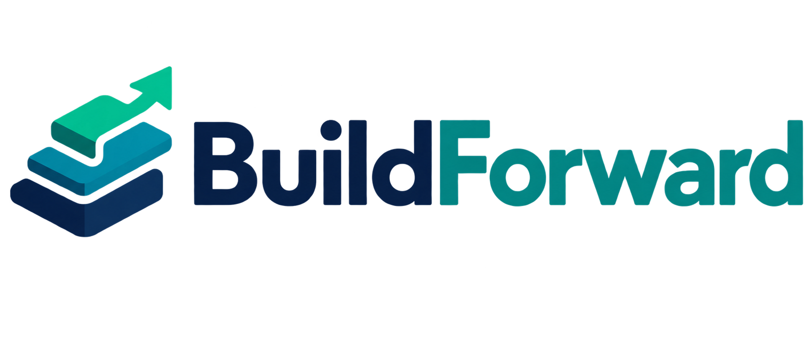
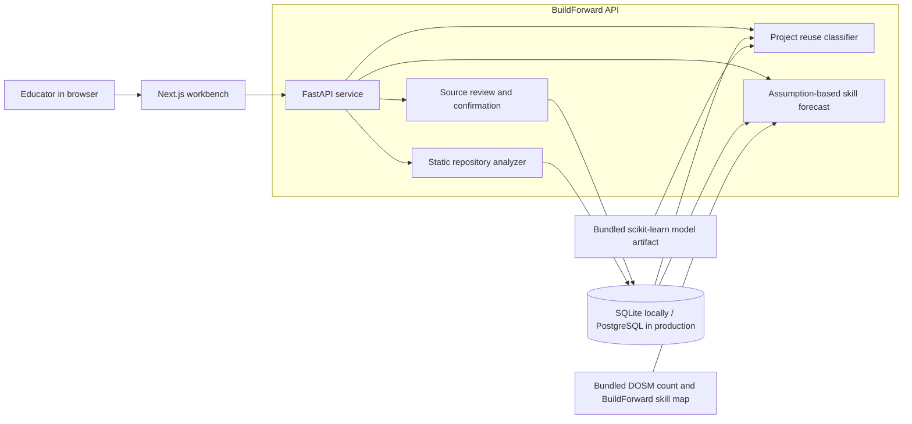

# BuildForward

<p align="center">
  
</p>

**BuildForward helps educators decide whether student project work can carry forward into a future module, and which skills may remain under-covered by graduation.** It brings project evidence, module goals, an illustrative skill forecast, and a possible action into one review workflow. Educators make the academic decisions.

- Live Demo: [https://buildforward.duckdns.org/](https://buildforward.duckdns.org/)
- OpenAPI Docs: [https://buildforward.duckdns.org/docs](https://buildforward.duckdns.org/docs)
- Presentation Slides: [https://buildforward.duckdns.org/slides.html](https://buildforward.duckdns.org/slides.html)

> **Proof of concept:** The default programme and project are illustrative, the student intake is simulated, and the forecast uses stated assumptions. BuildForward does not validate an institution's curriculum or predict an intervention's real effect.

## Why BuildForward?

Student projects often end when a module ends, even when later modules could build on the same work. A lecturer needs to know what the earlier project actually shows, whether it fits a future module's goals, and what students still need to learn. A programme leader also needs a way to spot possible skill gaps before graduation. BuildForward connects those questions while keeping source evidence and uncertainty visible.

## What you can do

| Work area | Educator task | Current implementation |
| --- | --- | --- |
| **Project Reuse Check** | Compare a selected project with a future module. | Shows detected evidence, required skills, missing skills, a trained classifier's `CONTINUE` / `PARTIAL_REUSE` / `RESET` result, and a simple rule-based comparison. The UI renders these as **Continue**, **Partially reuse**, and **Start new**. |
| **Graduation Skills Forecast** | Review expected coverage and gaps for a student intake. | Ranks skills using an assumed graduation target, future module opportunities, and a limited occupation-demand signal where mapped. An educator can set a hypothetical gain and compare the resulting gap. |
| **Data Sources** | Inspect material before using it. | Reviews coursework candidates and project evidence; analyzes public GitHub repositories or ZIP archives by static inspection; requires confirmation before candidate data can enter predictions. |

Programme and student-intake JSON import and confirmation are available through the API. The web interface currently supports the review flow and project repository/ZIP import; it does not provide every API import form.

### A complete demo decision

The default sample connects the three work areas:

1. **See the possible gap.** Unit Testing starts at **18%** coverage, is expected to reach **40%** by graduation, and remains **30 points** below the illustrative **70%** target.
2. **Check project reuse.** Compare the sample record-management project with the future Software Testing module. The illustrative result is **Continue**, with evidence and missing skills shown for review.
3. **Review a possible action.** BuildForward suggests considering testing work in the existing project because the gap, future module target, and reuse result support the same skill.
4. **Explore an assumption.** Set a **+18-point** hypothetical skill gain and update the scenario. The displayed gap changes from **30** to **12 points**. This is a user-set scenario, not a predicted or observed teaching effect.

The [golden demo guide](docs/golden-demo.md) gives the exact click path and presenter checks.

## Architecture



The browser calls the API for workspace data and predictions. The API stores sample, imported, and reviewed records with SQLAlchemy. Repository analysis reads supported source files and build metadata; it does not execute uploaded code. The reuse classifier loads a bundled model artifact. The forecast uses stored student-intake coverage, future module targets, fixed assumptions, and the bundled market snapshot. Prediction and action suggestions stop at educator review; BuildForward does not change assignments, curricula, LMS content, or student records.

### Tech stack

| Layer | Technology |
| --- | --- |
| Web | Next.js 16, React 19, TypeScript, CSS |
| API | Python 3.13, FastAPI, Pydantic, SQLAlchemy |
| Reuse model | scikit-learn classifier loaded from a joblib artifact |
| Database | SQLite for direct local runs; PostgreSQL 17 in Docker Compose |

## Try it locally

### Option A: Docker Compose

With Docker and Docker Compose installed, run from the repository root:

```bash
docker compose up --build
```

Open [http://localhost:3000](http://localhost:3000). This starts the web app, API, and a PostgreSQL database. The illustrative sample is seeded when the API starts. `docker compose down` stops the containers; the named database volume remains unless you explicitly remove it.

### Option B: Run the API and web app separately

Requirements: Python 3.13+, [uv](https://docs.astral.sh/uv/), Node.js 24+, and pnpm 10.32.1.

Terminal 1, from the repository root:

```bash
cd services/api
uv sync --locked --group dev
uv run uvicorn app.main:app --reload --port 8000
```

Terminal 2, from the repository root:

```bash
cd apps/web
pnpm install --frozen-lockfile
pnpm dev
```

Open [http://localhost:3000](http://localhost:3000). The web app defaults to `http://localhost:8000` for API calls. Direct local API runs use SQLite at `services/api/buildforward.db`. The [interactive API reference](http://localhost:8000/docs) is served by Scalar; the schema is at [http://localhost:8000/openapi.json](http://localhost:8000/openapi.json).

On first startup the API seeds the sample and review-only source candidates. Do not delete a database that contains imported work; deleting the local SQLite file recreates only the seeded records.

## Data, model, and claim boundaries

| Input or result | Current source | What it means |
| --- | --- | --- |
| Default programme, project, and student intake | Illustrative sample and simulated coverage | Demonstrates the full workflow; it is not a verified institutional programme or observed student batch. A **student intake** is a group progressing through a programme, not a semester. |
| Coursework and project candidates | Paraphrased summaries in [`data/candidates/`](data/candidates/README.md) | Review-only records. Original coursework and submission documents remain local and are not in this repository. The user-labeled Semester 1–5 briefs are not verified as one official programme; the Semester 1 brief identifies Diploma coursework. The separate Degree OODJ material is not merged into that sequence. |
| Project evidence | Report summaries or static repository inspection | Indicates possible skills and structure. It does not prove code quality, passing tests, individual proficiency, or permission to reuse a project for an assignment. |
| Project reuse result | Model trained on **72 synthetic rubric scenarios** | A proof-of-concept educational-fit signal, not a validated prediction of real student outcomes. A separate set of 15 hypothetical real-repository/module pairs has 13 project-owner-approved AI-proposed labels; 9 can be scored. Its descriptive macro-F1 is **0.62** versus **0.46** for the simple baseline. Four labels await a required-skill map and two same-module pairs are excluded. See [model method and limits](ml/README.md). |
| Graduation forecast | Current coverage, future module targets, and fixed assumptions | Uses a **70%** illustrative target and **22-point** assumed gain per future module targeting a skill. The action slider adds a separate user-set hypothetical gain. These are not observed effects or historically validated institutional forecasts. |
| Market signal | Fixed [DOSM Q2 2026 online-offering count](docs/market-data.md) plus BuildForward's own occupation-to-skill map | Helps order mapped skills for review. DOSM counted **19,899 Software Developer online offerings** out of **555,509** total. That is an occupation count, not a count of jobs requiring Unit Testing or any other mapped skill. Unmapped skills are shown without a market signal. |

Source confirmation means a person has reviewed extracted details; it does not verify a programme sequence or validate a forecast. Candidates with unknown required-skill mappings cannot be used for prediction. The [robustness note](docs/model-robustness.md) records noise, missing-data, and outlier checks and their limits.

## Import and review workflow

1. Import programme or student-intake coverage JSON through the [API](http://localhost:8000/docs), or inspect the seeded candidates in **Data Sources**. The relevant API routes are `POST /api/v1/programmes/import` and `POST /api/v1/cohorts/import`.
2. Review the candidate's source and required-skill mapping, then explicitly confirm it. The corresponding API routes are `POST /api/v1/programmes/{id}/confirm` and `POST /api/v1/cohorts/{id}/confirm`.
3. In **Data Sources**, inspect a public GitHub repository or upload a ZIP, review its extracted evidence, and confirm the project. The API routes are `POST /api/v1/projects/analyze-github`, `POST /api/v1/projects/analyze`, and `POST /api/v1/projects/{id}/confirm`.
4. Select the reviewed programme, intake, and project in the workspace header, then press **Load**. Run the project reuse check for a future module and explore the forecast scenario.

Repository inspection is static and accepts archives up to **20 MiB**. It skips data directories, database files, CSV/JSONL, environment files, and arbitrary text files. Review the original brief before changing any teaching activity: a reuse result estimates fit with learning goals, not assignment eligibility.

## Project Structure

```text
apps/web/              Next.js educator workbench
apps/web/public/       Hosted slides, visual explainer, and brand assets
services/api/          FastAPI routes, data models, seed, analyzer, and predictions
services/api/data/     Bundled DOSM snapshot and BuildForward skill mapping
services/api/artifacts/ Trained reuse-model artifact and metrics
ml/                    Training pipeline, synthetic scenarios, and review set
data/candidates/       Paraphrased, review-only coursework/project summaries
docs/                  Demo, market-data, and robustness notes
docker-compose.yml     Local PostgreSQL stack
```

## Verification

```bash
cd services/api
uv run pytest -q
uv run ruff check app tests

cd ../../ml
uv sync --locked --group dev
uv run pytest -q
uv run ruff check training tests

cd ../apps/web
pnpm typecheck
pnpm build
```

The API health check is `GET /api/v1/health`. The browser walkthrough in [docs/golden-demo.md](docs/golden-demo.md) verifies the connected educator flow.

## Further reading

- [Golden demo](docs/golden-demo.md): one reproducible educator decision path and presenter checks.
- [Market data](docs/market-data.md): DOSM source, BuildForward mapping, priority formula, and limits.
- [Model method](ml/README.md): training, held-out evaluation, real-repository review, and reproducibility.
- [Model robustness](docs/model-robustness.md): noise, missing-data, and outlier checks.
- [Interface design](DESIGN.md): navigation, evidence, and human-review rules.
- [Project handoff](HANDOFF.md): concept and scope notes; implementation details should be checked against the current code.
- [Visual explainer](https://buildforward.duckdns.org/explainer.html): how the three work areas connect.
